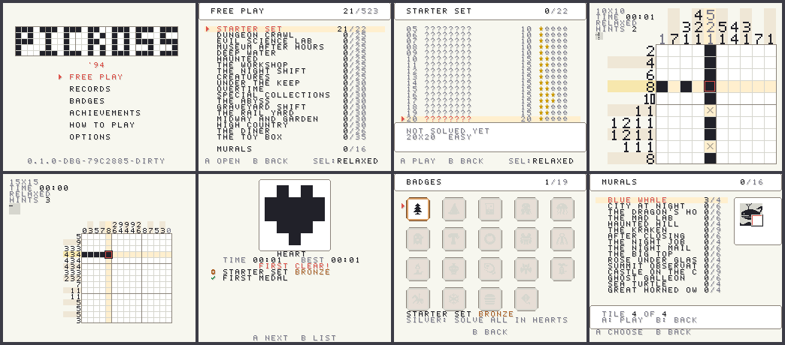
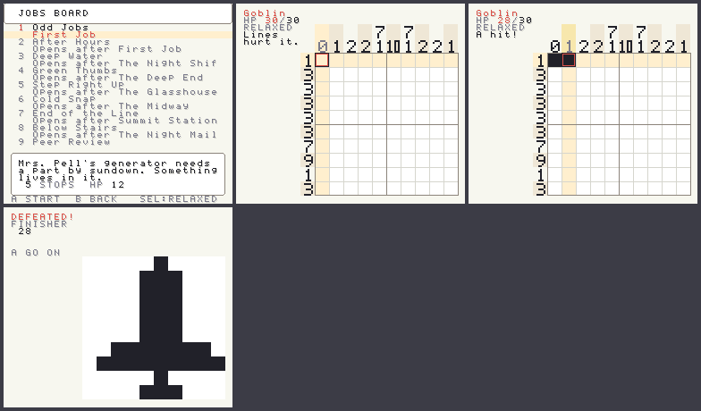

# Picross '94

[](https://github.com/austinthedeveloper/picross-snes/actions/workflows/ci.yml)

A Super Nintendo demake of the [Picross web game](https://github.com/austinthedeveloper/picross), built in C
and 65816 assembly with [PVSnesLib](https://github.com/alekmaul/pvsneslib)
4.6.0. It has that game's free play (all 523 handmade puzzles in their 19
collections plus the 16 murals, with the tracking, ranks, badges and
achievements around them) and its story mode: Rook and Dee's odd jobs,
chapter by chapter, with fights, digs, rest stops and scenes. The story is
imported from the web game and kept in step with it by a daily sync
(docs/decisions/ADR-010, ADR-011). Endless and the daily puzzle aren't in.



- 523 puzzles from 5×5 to 20×20, each one with a unique solution, drawn in
  the web game and imported as data (`data/pack.json`)
- 16 murals: big pictures in 90 tile puzzles that fill in as you solve them
- Relaxed or Hearts mode, 3 hints a puzzle, undo and redo, a clock
- Hold A or B to paint a stroke across cells, like dragging in the browser
- Records: rank (the same ten as the web game), totals, solves by size,
  play time
- A badge per collection (bronze, silver, gold) and 21 achievements
- Battery save: every record, plus one board to come back to
- Synthesized sound effects (pencil taps, line chimes, a solve jingle)
- Story mode: 10 chapters of jobs with the web game's scenes, portraits and
  backdrops; fights against enemies with the eight powers (fog, scrambles,
  armor, forgeries, charge, ink, swaps, turns), gadgets, Relaxed or Hits on



## Play

Download the ROM from the
[latest release](https://github.com/austinthedeveloper/picross-snes/releases/latest)
and open it in an emulator (Mesen 2 or bsnes) or from a flash cart. Every
CI run also uploads a ROM built from that commit.

## Build

Needs PVSnesLib 4.6.0 next to this repo (`../pvsneslib`, or set
`PVSNESLIB_HOME`), Python 3, a host C compiler, and MesenCE for the headless
runs.

```sh
make            # debug ROM in build/debug/
make release    # release ROM in build/release/
make check      # host tests, pack validation, 816-tcc lint
make smoke SMOKE=solve_heart SMOKE_FRAMES=560   # headless run + screenshots
```

Open the `.sfc` in an emulator (Mesen 2 or bsnes). It's a 256 KiB FastROM
LoROM with 8 KiB of battery SRAM.

## Controls

| Button | On the board                   | On the lists          |
| ------ | ------------------------------ | --------------------- |
| D-pad  | Move (repeats, wraps)          | Move                  |
| A      | Fill / erase (hold to paint)   | Choose                |
| B      | Mark X / unmark (hold to paint)| Back                  |
| L / R  | Undo / redo                    | Page (puzzle list: ←/→)|
| X      | Hint: cell, row or column      |                       |
| Start  | Pause: resume, restart, quit   |                       |
| Select |                                | Relaxed / Hearts      |

## Docs

- [Wiki](https://github.com/austinthedeveloper/picross-snes/wiki): how to
  play, building, testing, architecture, adding puzzles
- [CLAUDE.md](CLAUDE.md): workflow, the rules of the code, running headless
- [Product brief](docs/00_PRODUCT_BRIEF.md): what this version is and isn't
- [Layout](docs/LAYOUT.md): screens, VRAM, palettes, the board's placement
- [Puzzles](docs/PUZZLES.md): importing the pack, the ROM format, save slots
- [Tools](tools/README.md): every script, by what it's for
- [Decisions](docs/decisions/) (story mode: ADR-010, the web sync:
  ADR-011), [known issues](docs/KNOWN_ISSUES.md),
  [ideas](docs/IDEAS.md), [milestones](milestones/00_MASTER_CHECKLIST.md)
